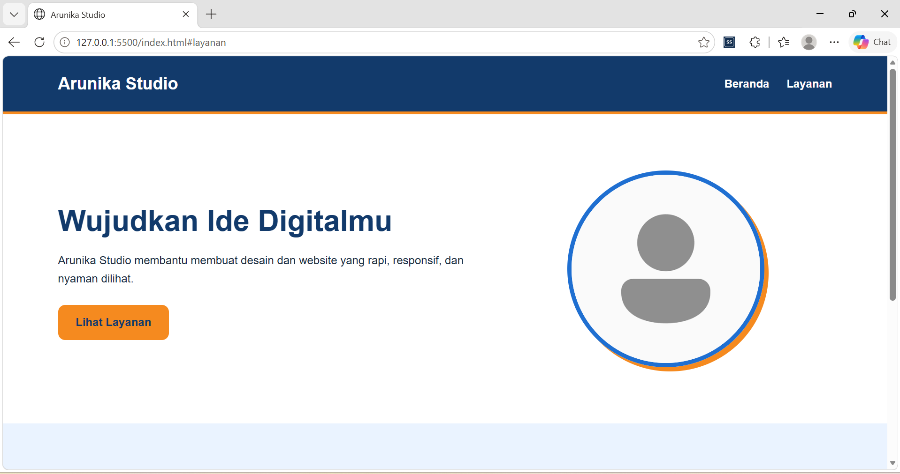
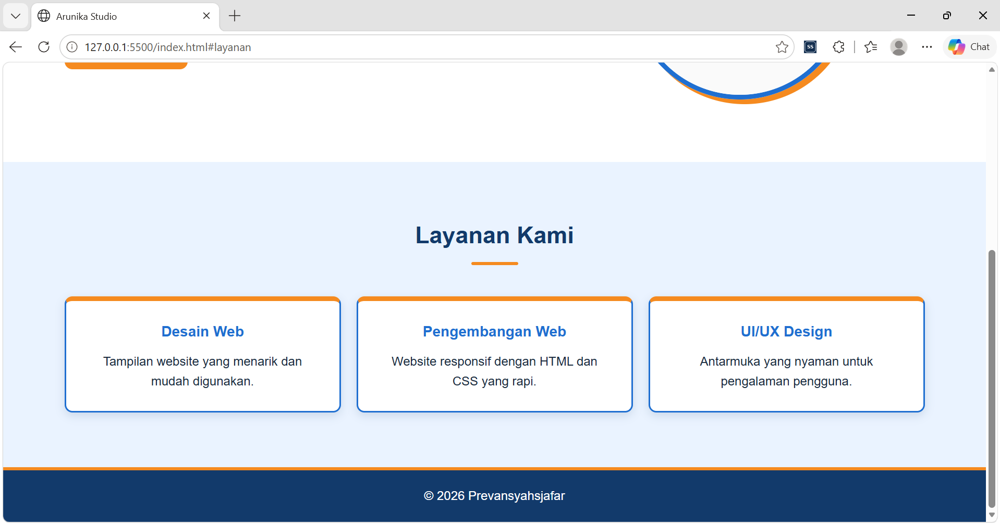
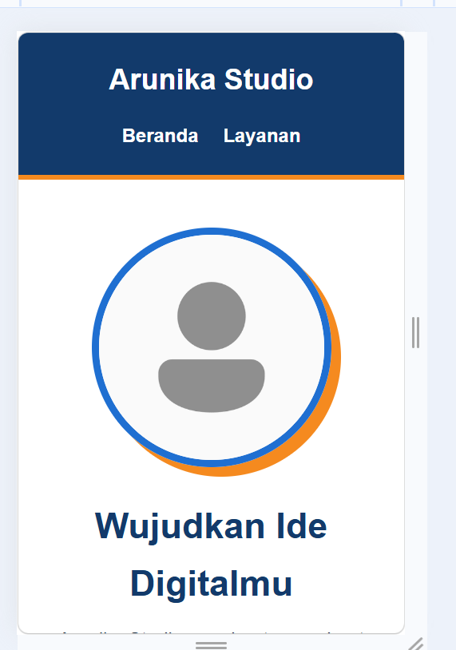

# Arunika Studio

Landing page sederhana untuk Arunika Studio, sebuah studio yang bergerak di bidang desain web, pengembangan web, dan UI/UX design.

## Fitur Website

* Header dengan navigasi Beranda dan Layanan.
* Hero section sebagai pengenalan studio, lengkap dengan tombol "Lihat Layanan" dan foto profil.
* Tiga card layanan: Desain Web, Pengembangan Web, dan UI/UX Design.
* Footer berisi hak cipta.
* Smooth scroll dan efek hover pada tombol, menu, dan card.
* Desain responsif untuk desktop dan perangkat mobile.

## Teknologi yang Digunakan

* HTML5 untuk struktur halaman.
* CSS3 untuk desain dan tata letak.
* Flexbox untuk mengatur posisi elemen.
* Media Query untuk menyesuaikan tampilan pada layar kecil.

## Struktur Folder

```text
arunika-studio/
├── index.html
├── README.md
├── css/
│   └── style.css
└── images/
    ├── profil.png
    ├── output1.png
    ├── output2.png
    └── output3.png
```


## Konsep Desain

Website menggunakan gaya modern minimalis dengan kombinasi warna:

* Navy Blue: `#123A6B`
* Sunrise Orange: `#F58A1F`
* Bright Blue: `#1F6FD1`
* Light Blue: `#EAF3FF`
* White: `#FFFFFF`

Desain dibuat sederhana agar informasi mudah dibaca dan identitas studio terlihat profesional.

## Responsive Design

Media query diterapkan pada layar di bawah 768px untuk menyesuaikan navigasi, ukuran teks, ukuran foto profil, dan susunan card layanan menjadi satu kolom.

## Tujuan Proyek

Proyek ini dibuat untuk mempraktikkan penggunaan HTML dan CSS eksternal, box model, class reusable, Flexbox, serta responsive design.

## Screenshot

Tampilan desktop (beranda):



Tampilan desktop (layanan dan footer):



Tampilan mobile:



